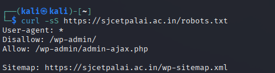
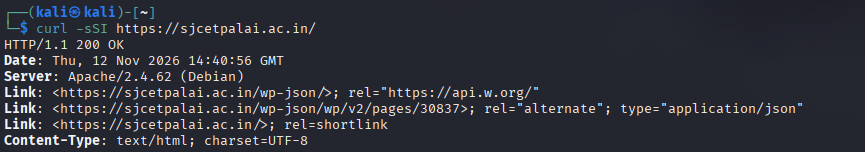

# OSINT Investigation Report
## External Digital Footprint Analysis of SJCET Palai

**Target Domain:** `sjcetpalai.ac.in`  
**Institution:** St. Joseph's College of Engineering and Technology, Palai  
**Assessment Date:** 12 November 2026  
**Tools Used:** ICANN Lookup, Kali Linux, DIG, OWASP Amass, crt.sh, OpenSSL, curl, Shodan and Google Search.

---

# 1. Introduction

This project was conducted to understand how Open Source Intelligence (OSINT) can be used to collect publicly available information about an organisation.

For this investigation, I selected the domain `sjcetpalai.ac.in`, which belongs to St. Joseph's College of Engineering and Technology, Palai.

The main purpose was to understand the organisation's publicly visible digital footprint. I wanted to identify its domain registration details, DNS records, subdomains, SSL certificates, hosting infrastructure, third-party services and publicly indexed information.

I used different OSINT tools and command-line utilities to collect and analyse the information.

This project was conducted as a student learning exercise. I did not have permission to perform penetration testing or vulnerability scanning. Therefore, I limited the investigation to publicly available information and passive checks, along with ordinary read-only requests to public website resources.

# 2. Objectives

The main objectives of this investigation were:

1. To collect publicly available domain registration information.
2. To understand the DNS configuration of the domain.
3. To identify publicly known subdomains.
4. To examine SSL/TLS certificate information.
5. To identify publicly observed hosting and infrastructure details.
6. To understand the use of third-party services.
7. To examine the publicly available robots.txt file.
8. To review HTTP response headers.
9. To identify publicly indexed documents and website pages through Google.
10. To document the findings in a structured report.

# 3. Methodology

I followed a step-by-step approach to conduct the investigation.

I started with domain registration information and then moved to DNS enumeration and subdomain discovery. After that, I examined Certificate Transparency records and SSL certificates.

I also used Shodan to understand publicly observed internet infrastructure. I checked third-party service relationships, robots.txt, HTTP response headers and Google search results.

The information collected from different sources was compared wherever possible to improve the accuracy of the findings.

# 4. Practical Implementation

## 4.1 Domain Registration Analysis

**Tool used:** ICANN Lookup

I started the investigation by performing a domain registration lookup using ICANN Lookup.

The purpose was to understand the registration details of the target domain.

The lookup provided the following information:

- Domain name: sjcetpalai.ac.in
- Registrar: ERNET India
- Domain creation date: 29 March 2006
- Last updated date: 16 March 2024
- Expiration date: 29 March 2033
- Nameservers: ns1.contabo.net, ns2.contabo.net and ns3.contabo.net
- Domain status: Active
- DNSSEC status: Unsigned

Some administrative registration information was redacted.

The lookup also showed that the domain uses Contabo nameservers.

I learned that a registrar, DNS provider and web hosting provider are not necessarily the same organisation.


## 4.2 DNS Enumeration

**Tool used:** DIG (Kali Linux)

After completing the registration lookup, I moved to DNS enumeration.

I used the DIG command to retrieve different DNS records for the target domain.

The following command was used:

```bash
dig sjcetpalai.ac.in A
```

I also checked AAAA, MX, NS and TXT records.

The results were:

| DNS record | Finding |
|---|---|
| A | 75.119.155.105 |
| AAAA | No answer returned |
| MX | alt1.aspmx.l.google.com |
| NS | ns1.contabo.net |
| NS | ns2.contabo.net |
| NS | ns3.contabo.net |
| TXT | No answer returned |

The MX record indicates a relationship with Google's mail infrastructure.

The three nameservers belong to the Contabo DNS namespace.

The AAAA and TXT queries returned NOERROR responses with zero answer records. An SOA record appeared in the Authority section. This provided information about the DNS zone but did not mean that AAAA or TXT records were found.

This activity helped me understand different DNS record types and how they provide information about domain infrastructure.


## 4.3 Passive Subdomain Enumeration

**Tool used:** OWASP Amass v4.2.0

I used OWASP Amass in passive mode to identify publicly known subdomains associated with the target domain.

The command used was:

```bash
amass enum -passive -d sjcetpalai.ac.in
```

The results revealed several hostnames and infrastructure relationships.

Some of the discovered subdomains included:

- admission.sjcetpalai.ac.in
- adsa.sjcetpalai.ac.in
- aeilms.sjcetpalai.ac.in
- admapi.sjcetpalai.ac.in
- nexus.sjcetpalai.ac.in
- tedx.sjcetpalai.ac.in
- buspass.sjcetpalai.ac.in
- alumni.sjcetpalai.ac.in
- langlab.sjcetpalai.ac.in
- news.sjcetpalai.ac.in

The results also contained information about A records, AAAA records and CNAME relationships.

I noticed that some subdomains were associated with different hosting providers.

This exercise helped me understand how passive subdomain enumeration can provide additional information about an organisation's public digital footprint.

The discovered hostnames were not all independently verified as active services.


## 4.4 Certificate Transparency Investigation

**Tool used:** crt.sh

Next, I used crt.sh to investigate publicly logged SSL/TLS certificates.

I searched for:

`%.sjcetpalai.ac.in`

The search returned multiple certificate records associated with the target domain.

I observed Let's Encrypt as a certificate issuer. The results also revealed several additional hostnames.

Some examples included:

- www.sjcetpalai.ac.in
- sjihmct-ns.sjcetpalai.ac.in
- sjcet.koha.sjcetpalai.ac.in
- gate.sjcetpalai.ac.in
- seatsyc.sjcetpalai.ac.in
- adsa.sjcetpalai.ac.in
- mozilla.sjcetpalai.ac.in
- librepo.sjcetpalai.ac.in
- alumni.sjcetpalai.ac.in
- langlab.sjcetpalai.ac.in

I also opened an individual certificate record to understand its details.

The certificate record showed:

- Common Name: www.sjcetpalai.ac.in
- Issuer: Let's Encrypt YE2
- Certificate type: Precertificate
- Public key algorithm: EC
- Public key size: 256 bits
- Signature algorithm: ECDSA with SHA-384

The Subject Alternative Name field contained www.sjcetpalai.ac.in.

I learned that Certificate Transparency logs can help identify hostnames that may not be discovered through basic DNS queries.

I also learned that a certificate appearing in CT logs does not necessarily mean that the hostname is currently active.


## 4.5 SSL/TLS Certificate Analysis

**Tools used:** Chrome Certificate Viewer, Qualys SSL Labs and Kali Linux curl.

I examined the SSL/TLS certificate presented for the main domain and its www hostname.

The certificate details for the main domain showed:

- Subject: sjcetpalai.ac.in
- Issuer: Let's Encrypt YE1
- Valid from: 7 October 2026
- Valid until: 5 January 2027

I also checked the Subject Alternative Name field.

The displayed SAN contained:

`sjcetpalai.ac.in`

The hostname `www.sjcetpalai.ac.in` was not present in the displayed SAN entry.

When I checked the www hostname using curl, the command returned a certificate hostname mismatch message.

Qualys SSL Labs also reported a certificate name mismatch for the www hostname.

This suggests that the certificate presented during the www connection did not cover the requested hostname.

A hostname mismatch can cause browsers to display security warnings or reject the connection.

However, I did not attempt to modify or test the website's certificate configuration because I did not have permission.


## 4.6 Internet Exposure Analysis

**Tool used:** Shodan

I used Shodan to examine publicly available information about the IP address discovered during DNS enumeration.

The IP address investigated was:

`75.119.155.105`

Shodan displayed the following information:

- Associated hostname: db.sjcetpalai.ac.in
- Hosting organisation: Contabo GmbH
- ASN: AS51167
- Country: Germany
- City: Düsseldorf

This was interesting because the college is located in Palai, Kerala, India, but the hosting IP was associated with infrastructure in Germany.

I learned that an organisation's physical location and its server hosting location can be different.

Shodan also displayed eight TCP ports as open in its records:

22, 80, 443, 4000, 4369, 5672, 10000 and 61613.

The service information included SSH, HTTP and HTTPS.

The technology information displayed by Shodan included:

- Apache HTTP Server 2.4.62
- Debian
- PHP
- MySQL
- phpMyAdmin
- Bootstrap
- jQuery

Shodan also displayed several HTTP security headers and potential CVE associations.

I learned that Shodan collects information about internet-connected systems and that its results may not always represent the current state of a server.

The displayed vulnerability associations were treated as potential matches only. I did not independently verify or exploit any vulnerabilities.


## 4.7 Third-Party and Service Mapping

**Tool used:** DIG

In this phase, I investigated the CNAME records of selected subdomains.

The purpose was to identify relationships with external hosting platforms.

I used DIG to verify the following records.

| Subdomain | CNAME destination | Provider association |
|---|---|---|
| nexus.sjcetpalai.ac.in | nexussjcet.github.io | GitHub Pages |
| adsa.sjcetpalai.ac.in | cname.vercel-dns.com | Vercel |
| buspass.sjcetpalai.ac.in | e6f949346ecceda2.vercel-dns-017.com | Vercel |
| tedx.sjcetpalai.ac.in | tedxsjcet.github.io | GitHub Pages |

The DNS queries confirmed these CNAME relationships at the time of testing.

From this activity, I understood that organisations may use different external platforms to host their websites and applications.

These relationships provide useful information about third-party service dependencies.


## 4.8 robots.txt Inspection

**Tool used:** curl

I retrieved the publicly available robots.txt file using:

```bash
curl -sS https://sjcetpalai.ac.in/robots.txt
```

The file contained:

`User-agent: *`

`Disallow: /wp-admin/`

`Allow: /wp-admin/admin-ajax.php`

It also included the sitemap location:

`https://sjcetpalai.ac.in/wp-sitemap.xml`

The results indicate that the website uses WordPress-related functionality.

The robots.txt file provides instructions to search engine crawlers about which paths should or should not be crawled.

I learned that robots.txt does not provide access control or protect restricted directories.

The presence of a disallowed path does not automatically indicate a security vulnerability.


<!-- Add your robots.txt output screenshot here -->

## 4.9 HTTP Header Analysis

**Tool used:** curl

I used curl to retrieve the HTTP response headers.

The command was:

```bash
curl -sSI https://sjcetpalai.ac.in/
```

The response contained the following information:

- HTTP status: 200 OK
- Server: Apache/2.4.62 (Debian)
- Content-Type: text/html; charset=UTF-8

The response also contained WordPress-related Link headers, including a reference to the WordPress REST API.

I then checked selected security headers:

- Content-Security-Policy
- X-Frame-Options
- X-Content-Type-Options
- Strict-Transport-Security
- Referrer-Policy
- Permissions-Policy

These headers were not observed in the captured response.

This does not automatically mean that the website is vulnerable. It only records what was returned in the particular response that I examined.

This activity helped me understand how HTTP headers can reveal server information and provide insight into browser security configurations.



## 4.10 Google Dorking and Search Engine OSINT

**Tool used:** Google Search

I used Google search operators to identify publicly indexed information associated with the target domain.

Some of the search operators used were:

- `site:`
- `filetype:`
- `intitle:`
- `inurl:`
- Exact phrase searches

I performed searches for publicly available PDF documents, logos and website pages.

The results included:

1. Public PDF documents.
2. College logos and image resources.
3. Public website pages.

I did not identify other document types in the searches I conducted.

The search results helped me understand how Google indexes publicly available website information.

I also learned that Google does not index every file or page on a website. Therefore, the absence of a search result does not prove that a resource does not exist.


# 5. Tools Used

The following tools were used during this project.

| Tool | Purpose |
|---|---|
| ICANN Lookup | Domain registration information |
| DIG | DNS record investigation |
| OWASP Amass | Passive subdomain discovery |
| crt.sh | Certificate Transparency investigation |
| Chrome Certificate Viewer | SSL/TLS certificate inspection |
| Qualys SSL Labs | Public SSL/TLS assessment |
| curl | HTTP requests and header analysis |
| Shodan | Public internet exposure information |
| Google Search | Search engine OSINT |

# 6. Key Learnings

This project helped me understand how OSINT works in a practical environment.

Some of the important things I learned were:

1. How to investigate domain registration information.
2. How to use DIG to identify DNS records.
3. How to discover subdomains using passive enumeration.
4. How Certificate Transparency logs help identify additional hostnames.
5. How SSL/TLS certificates establish website identity.
6. How to identify certificate hostname mismatches.
7. How Shodan provides information about publicly observed internet services.
8. How to identify third-party hosting relationships through CNAME records.
9. How robots.txt provides search engine crawler instructions.
10. How HTTP headers reveal server and security configuration information.
11. How Google search operators help find publicly indexed information.
12. Why findings must be verified before making security conclusions.

# 7. Limitations

This investigation was conducted as a student learning project without formal authorization from the institution.

Therefore, I did not perform penetration testing, vulnerability scanning, brute-force activities, authentication testing or attempts to access restricted resources.

Some findings were collected from third-party databases and may be outdated or incomplete.

DNS records and certificate information can also change over time.

Shodan observations were not independently verified through active scanning.

The results should therefore be understood as observations of publicly available information at the time of the investigation.

# 8. Conclusion

Through this project, I was able to understand how different OSINT tools can be used together to investigate an organisation's public digital footprint.

I started with basic domain registration information and gradually moved towards DNS enumeration, subdomain discovery, certificate analysis, infrastructure mapping and search engine investigation.

One of the most interesting parts of the project was discovering the relationships between different subdomains and external hosting providers such as GitHub Pages and Vercel.

I also learned how to identify certificate hostname mismatches and interpret HTTP response headers.

Overall, this project gave me practical experience with Kali Linux, DNS utilities and several OSINT platforms. It also helped me understand the importance of verifying findings, documenting evidence and respecting the boundaries of an authorised security assessment.

This project improved my understanding of how threat intelligence and OSINT support an organisation's external security awareness.
